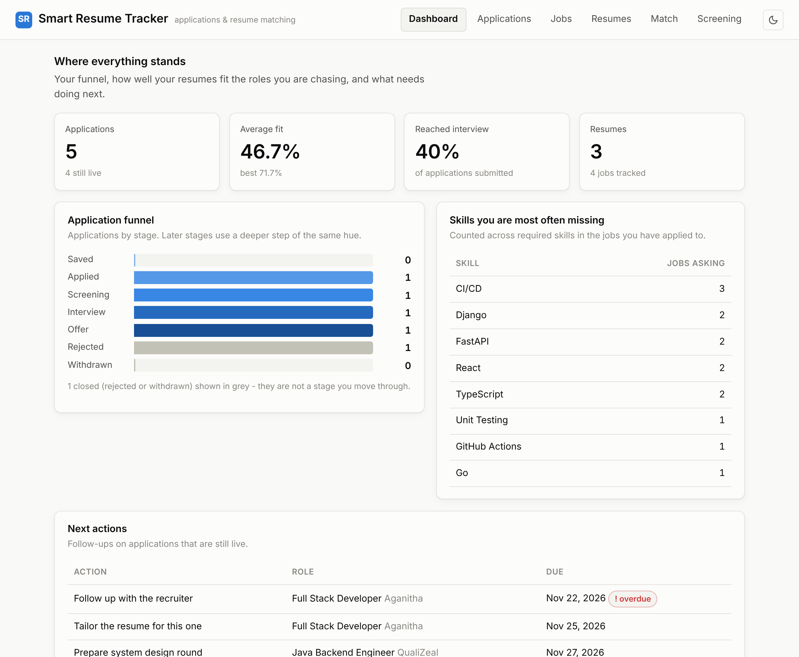
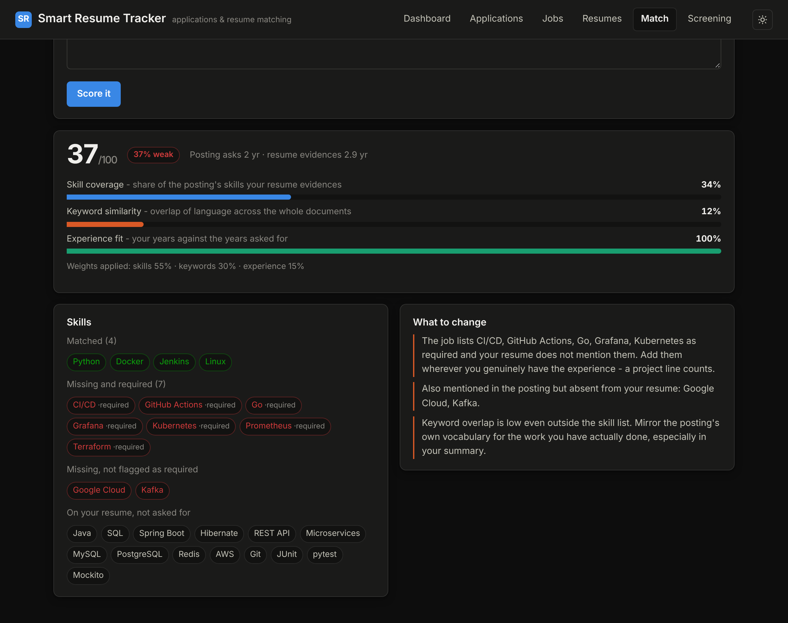

# Smart Resume Tracker

Track your job applications **and** see how well each resume actually answers the
posting you are sending it to - then flip the same engine around and rank a pile
of resumes against one job, the way a recruiter would.

One parsing and scoring core serves both sides, so a score means the same thing
whichever direction you read it from.



---

## Why this is not another CRUD tracker

A spreadsheet can store the jobs you applied to. What it cannot tell you is
*why* you are not hearing back. This app answers that:

- **Every application carries a fit score** against the posting it went to, broken
  into skill coverage, keyword similarity and experience fit - never a single
  opaque number.
- **Gaps are named, not implied.** "The job lists Mockito and Unit Testing as
  required and your resume does not mention them."
- **The dashboard ranks the skills you are missing most often** across every job
  you have applied to, which turns a stack of rejections into a study list.
- **Resume health checks** run independently of any job: contact details, length,
  quantified impact, standard sections, stack breadth.



---

## Quick start

### Windows (PowerShell)

```powershell
git clone https://github.com/Sravani-Deepthi-Gadi/smart-resume-tracker.git
cd smart-resume-tracker

python -m venv .venv
.\.venv\Scripts\Activate.ps1

pip install -r requirements.txt
python scripts/seed_demo.py          # optional: demo data to click around in
uvicorn app.main:app --reload
```

If PowerShell blocks the activate script, run
`Set-ExecutionPolicy -Scope Process -ExecutionPolicy Bypass` first.

### macOS / Linux

```bash
git clone https://github.com/Sravani-Deepthi-Gadi/smart-resume-tracker.git
cd smart-resume-tracker

python3 -m venv .venv
source .venv/bin/activate

pip install -r requirements.txt
python scripts/seed_demo.py          # optional
uvicorn app.main:app --reload
```

Then open **http://127.0.0.1:8000**. Interactive API docs are at `/docs`.

Requires Python 3.10 or newer. There is no database server to install (SQLite),
no Node build step, and no model download.

---

## How the score is built

The overall score is a weighted blend of three signals, each reported on its own
so the number is always explainable.

| Signal | Weight | What it measures |
|---|---|---|
| Skill coverage | 0.55 | Share of the posting's skills your resume evidences, with skills under a "required" heading weighted about 3x those under "nice to have" |
| Keyword similarity | 0.30 | Cosine similarity of TF-IDF vectors over the full documents - catches domain language the taxonomy does not list |
| Experience fit | 0.15 | Your years against the years the posting asks for, capped at 100% |

**Unusable signals drop out rather than scoring zero.** If a posting names no
required years, experience is excluded and its weight is redistributed across the
other two - so a score is never dragged down by a question the posting never asked.
The weights actually applied are returned with every match.

### The pieces behind it

**Skill taxonomy** (`app/core/skills.py`) - 110+ canonical skills, each with the
surface forms resumes really use. `js` -> JavaScript, `k8s` -> Kubernetes,
`springboot` -> Spring Boot. Matching is boundary-aware and handles the cases
naive substring search gets wrong:

- `Java` is not found inside `JavaScript`, and `SQL` is not found inside `MySQL`
- `Go` is not found inside `going`
- `AWS.` and `C++.` at the end of a sentence still match
- `Spring Boot` does not also register as a bare `Spring`
- a space in an alias also matches a hyphen, so `unit-test coverage` counts as Unit Testing

**Required vs preferred** (`app/core/scoring.py`) - the job description is walked
line by line and each line is attributed to whichever heading last opened
("Required skills", "Minimum qualifications" vs "Nice to have", "Bonus"). Skills
under a hard-requirement heading cost far more when missing.

**TF-IDF** - implemented in the standard library, fitted on every job description
you have saved. Once there are three or more, terms that appear in every posting
("python", "agile") stop dominating and the terms specific to *this* posting start
to count. Below three it degrades gracefully to stopword-filtered TF cosine
rather than to noise.

**Experience parsing** - date ranges are read from the resume
(`Mar 2026 - Jul 2026`, `Jan 2024 - Present`) and **overlapping ranges are merged**,
so a concurrent internship and part-time role do not double-count the same months.
A stated "3+ years of experience" is the fallback when no dates are found.

Everything is deterministic: the same inputs always produce the same score, and
every decision is a line of Python you can point at in an interview.

---

## What is in the box

| View | What it does |
|---|---|
| **Dashboard** | Funnel by stage, average and best fit, interview rate, overdue next actions, and the skills you are most often missing |
| **Applications** | Every application with its cached fit score; change stage inline |
| **Jobs** | Paste a posting and see exactly how its requirements were read |
| **Resumes** | Upload PDF / DOCX / TXT or paste text; parsed fields and health checks per version |
| **Match** | Score any resume against any saved job, or against a posting you paste without saving |
| **Screening** | Recruiter side: upload a batch of resumes and rank them against one job |

---

## Project layout

```
app/
  main.py            FastAPI app, routers, static mount
  config.py          settings (env vars prefixed SRT_)
  database.py        engine, session, Base
  models.py          Resume, Job, Application, ScreeningRun, ScreeningCandidate
  schemas.py         Pydantic request/response contracts
  services.py        shared logic: corpus building, scoring, serialisation
  core/
    skills.py        skill taxonomy and boundary-aware extraction
    parser.py        PDF/DOCX/TXT extraction, contact fields, sections, dates
    scoring.py       TF-IDF, job analysis, match scoring, advice, health checks
  api/
    resumes.py  jobs.py  applications.py  matching.py  screening.py  stats.py
  static/
    index.html  styles.css  app.js        the whole front end, no build step
tests/               108 tests
scripts/seed_demo.py demo data
samples/             a sample resume (txt + pdf) and job description
```

---

## API

All responses are JSON. Full interactive documentation at `/docs`.

| Method | Path | Purpose |
|---|---|---|
| `GET` | `/api/health` | Liveness probe |
| `GET POST` | `/api/resumes` | List resume versions / add one from pasted text |
| `POST` | `/api/resumes/upload` | Upload a PDF, DOCX or TXT resume |
| `GET DELETE` | `/api/resumes/{id}` | One resume with parsed fields and health checks |
| `POST` | `/api/resumes/{id}/primary` | Mark a resume as the default |
| `GET POST` | `/api/jobs` | List / add jobs |
| `GET PATCH DELETE` | `/api/jobs/{id}` | One job, with required vs preferred skills extracted |
| `GET POST` | `/api/applications` | List (filter with `?status=`) / track an application |
| `GET PATCH DELETE` | `/api/applications/{id}` | Update stage, notes, next action |
| `POST` | `/api/match` | Score a resume against a job (ids, raw text, or a mix) |
| `GET POST` | `/api/screening/runs` | List / create a ranked screening run |
| `GET DELETE` | `/api/screening/runs/{id}` | One run with its ranked candidates |
| `GET` | `/api/stats` | Dashboard metrics |

Example:

```bash
curl -X POST http://127.0.0.1:8000/api/match \
  -H "Content-Type: application/json" \
  -d '{"resume_id": 1, "job_id": 1}'
```

```json
{
  "overall": 71.4,
  "verdict": "good",
  "skill_score": 84.4,
  "keyword_score": 33.2,
  "experience_score": 100.0,
  "matched_skills": ["Java", "Spring Boot", "Hibernate", "REST API", "MySQL"],
  "missing_required": ["Unit Testing"],
  "weights_used": {"skills": 0.55, "keywords": 0.3, "experience": 0.15},
  "suggestions": ["The job lists Unit Testing as required and your resume does not mention it. ..."]
}
```

---

## Tests

```bash
pytest -q          # 108 tests
pytest -v          # see what each one checks
```

Each test runs against its own throwaway SQLite file, so they are order-independent
and leave nothing behind. Coverage spans the taxonomy's boundary cases, PDF and
DOCX extraction, overlapping-date arithmetic, score composition and weight
redistribution, and every API route including its error paths.

---

## Configuration

Environment variables, or a `.env` file in the project root. All are optional.

| Variable | Default | Purpose |
|---|---|---|
| `SRT_DATABASE_URL` | `sqlite:///data/tracker.db` | Any SQLAlchemy URL |
| `SRT_MAX_UPLOAD_BYTES` | `5242880` | Per-resume upload limit (5 MB) |
| `SRT_MAX_SCREENING_FILES` | `50` | Resumes per screening run |
| `SRT_WEIGHT_SKILLS` | `0.55` | Skill coverage weight |
| `SRT_WEIGHT_KEYWORDS` | `0.30` | Keyword similarity weight |
| `SRT_WEIGHT_EXPERIENCE` | `0.15` | Experience fit weight |

---

## Known limits

Worth saying out loud rather than discovering in a demo:

- **Scanned PDFs are rejected**, not OCR'd. A PDF that is really an image yields no
  text; the upload returns a clear message telling you to paste the text instead.
- **Scoring is lexical, not semantic.** It will not infer that "built CI pipelines"
  implies Jenkins. Adding embeddings would fix that at the cost of a model
  download and the determinism that makes the current score explainable.
- **The skill taxonomy is hand-curated**, so a skill it has never heard of is
  invisible to the skill signal - though the keyword signal still picks it up.
  Adding one is a single line in `app/core/skills.py`.
- **Single user, no authentication.** It is designed to run on your own machine.
  Put it behind auth and tighten the CORS settings in `app/main.py` before hosting it.

---

## License

MIT - see [LICENSE](LICENSE).
